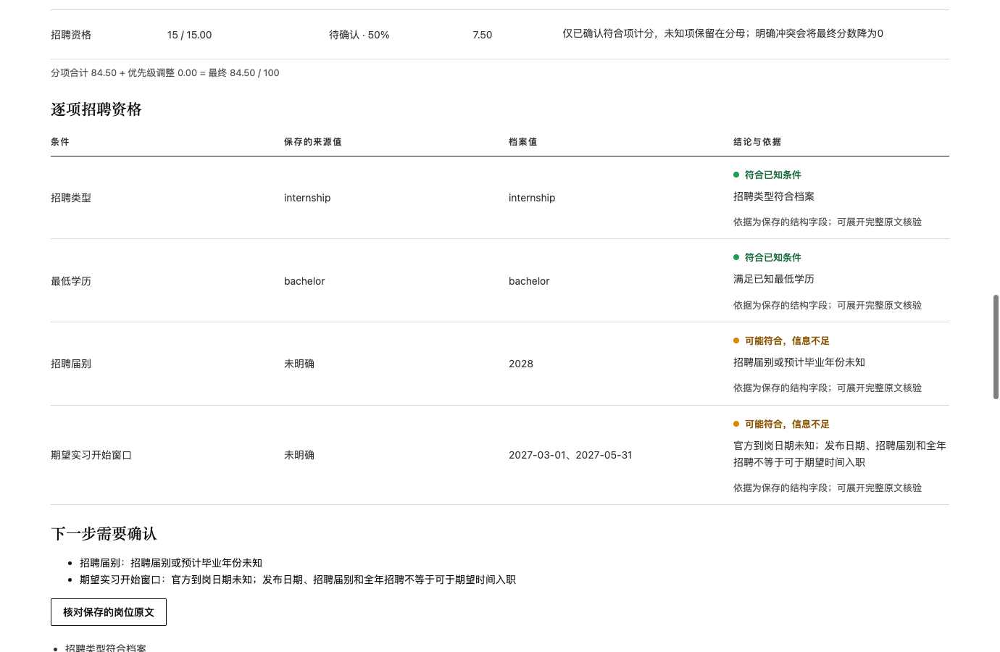
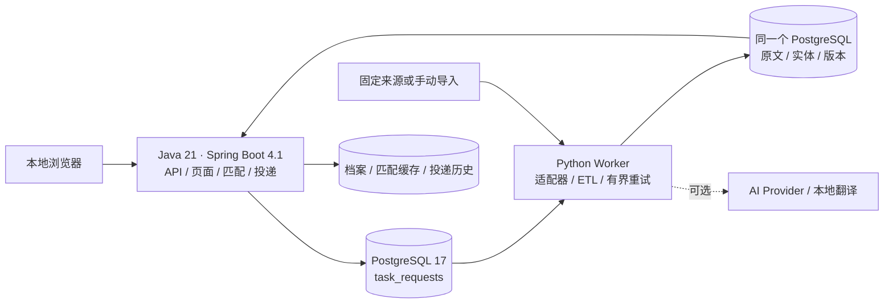
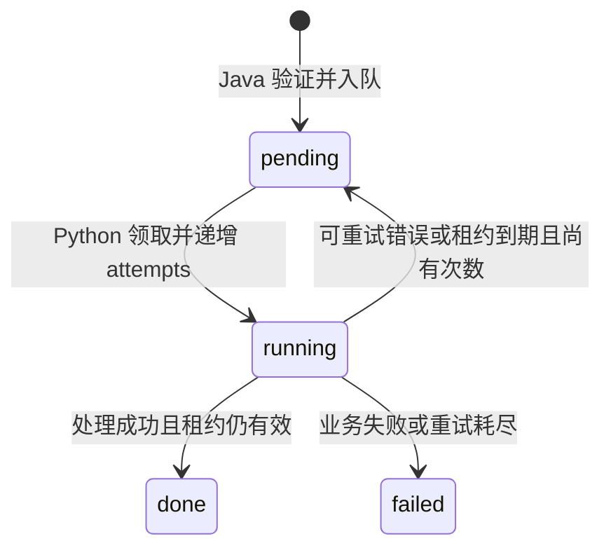

# SignalHub｜本地职业情报工作台

招聘信息会过期，JD 会更新，而“技能对得上”也不代表满足申请资格。SignalHub 把官方链接、JD 原文和历史版本存在本机，用可解释的规则筛选岗位，再跟踪收藏、投递进度和提醒。不配置 AI Key 也能完整使用主要功能。

它面向本机单用户：默认只监听回环地址，带 Host 校验、CSRF 和 CSP。目前没有账号认证和多用户隔离，不要直接暴露到公网。V1.0 要求的连续 72 小时稳定性验证还没有完成。

项目在 AI 辅助下完成。

## 跑一条合成 JD

需要 Python 3.12、JDK 21、Maven 3.9 和 PostgreSQL 17（建议用最新的 17 系列补丁版本）。把 `java`、`mvn`、`pg_ctl`、`initdb` 放进 PATH，或者设置 `JAVA_HOME` 和 `PG_BIN`。

```sh
python3.12 -m venv .venv
.venv/bin/python -m pip install --upgrade 'pip>=26.2'
.venv/bin/python -m pip install -e 'data-pipeline-python[test]'
./scripts/mvn.sh -f backend-java/pom.xml -DskipTests package
.venv/bin/python scripts/public_demo.py
```

按终端打印的地址打开岗位详情，再看“数据源与任务”和“投递管理”两页。

演示会新建一个临时数据库，使用随机口令和独立端口，里面只有项目自己写的虚构 JD 和档案，运行时不访问任何外部招聘、AI 或翻译服务（安装依赖时需要联网）。按 Ctrl+C 会清理这次的临时实例；加 `--verify-only` 则校验完就退出。更多说明见[演示步骤和隔离方式](docs/PUBLIC_DEMO.md)。



上图是合成“数据工程实习”岗位的实际运行结果：合成档案确认了 Python、SQL 和目标城市。JD 后来加了 Spark 加分项，生成 V2，旧分数随即隐藏；重新计算得到 **84.5/100**（界面上取整显示 85）。JD 没写 2027 年春季的到岗时间，所以“招聘资格”一栏仍是“信息不足”。评分只说明条件的匹配程度，不是录用概率，合成数据也不会被标成真实在招。

## 架构



Java 负责页面、API、规则匹配和投递记录，并把采集任务写进 `task_requests` 队列；Python Worker 领取任务，完成抓取、清洗和入库。两边只通过同一个 PostgreSQL 交换数据。



| 表 | 作用 |
|---|---|
| `raw_records` / `items` / `item_versions` | 先保存原文，再在同一事务里写规范化实体和版本。来源标识、规范化 URL、唯一约束和事务锁用来防重复。 |
| `task_requests` | 用 `FOR UPDATE SKIP LOCKED` 领取任务，15 分钟租约加 `attempts` 防止旧 Worker 覆盖新结果；最多重试 3 次，重放是幂等的。 |
| `user_profiles` / `employer_reviews` / `match_results` | 岗位版本、档案更新时间、算法版本、企业核验版本只要有一个变了，旧评分就不再展示；刷新时只重算变了的部分。 |
| `job_applications` / `application_history` | 本地的收藏和投递状态历史，不会向雇主发送任何材料。 |
| `reading_translation_jobs` / `reading_translations` | 译文按原文哈希和模型版本隔离，原文始终保留，人工核验过的译文优先。 |

表结构只通过 Flyway V1–V12 创建和迁移。数据来源有 GitHub Releases、Greenhouse、Ashby、SmartRecruiters、Lever、RSS/Atom，以及手动导入的 JD/CSV/JSON，它们共用同一条处理管道。

几条数据上的约定：
- 接口能公开访问，不等于允许转载正文。
- 归档里有一条岗位，不等于它现在还在招。
- 企业归属以核验证据为准，工作地点单独判断，未知字段不会猜测补全。
- 截止日期按上海时区的日历日显示，不是精确到时刻的截止时间。

## AI 与测试

- 规则匹配由 Java 完成。可选的 LLM 由 Python 调用，默认关闭，输出要通过 schema 校验和原文证据校验。Mock 模式用固定响应测试接口和降级流程。
- 本地翻译是可选项，用 Argos 英中模型和 CTranslate2 在 CPU 上离线推理。没有配置时，页面显示英文原文。演示不加载模型，也不做任何推理调用。
- 通过的测试数量、依赖版本、容器和远程 CI 覆盖的范围见[验收记录](docs/PUBLIC_ACCEPTANCE.md)，事务边界和源码入口见[架构说明](docs/ARCHITECTURE.md)。

[合成投递页面：已收藏与已投递均为本地记录](docs/demo-assets/applications.png) · [源码阅读路线](docs/PORTFOLIO_LEARNING.md) · [第三方声明](docs/THIRD_PARTY_NOTICES.md)

## 许可证

尚未选择许可证，在选定之前不授予任何使用、修改或分发权限。第三方组件的许可见[第三方声明](docs/THIRD_PARTY_NOTICES.md)。
