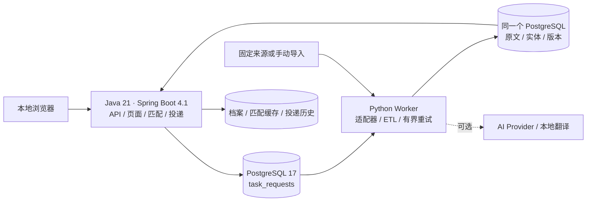
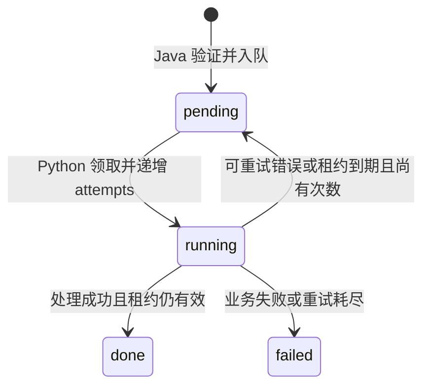

# SignalHub｜本地职业情报工作台

招聘信息会过期，JD 会更新，而“技能对得上”并不代表满足申请资格。SignalHub 把官方链接、原文和历史版本保存在本机，用可解释规则筛选机会，再跟踪收藏、投递进度和提醒。主要业务在没有 AI Key 的情况下可运行。

这是 **GitHub 源码展示候选**。SignalHub 面向本机单用户，默认只监听回环地址，启用 Host 校验、CSRF 和 CSP。公网账户认证和多用户隔离尚未实现。正式 V1.0 仍需完成连续 72 小时稳定性验证。

## 运行一条合成 JD

准备 Python 3.12、JDK 21、Maven 3.9 和 PostgreSQL 17（推荐使用 17 系列最新安全补丁）。将 `java`、`mvn`、`pg_ctl` 和 `initdb` 放进 PATH，或配置 `JAVA_HOME` 和 `PG_BIN`。

```sh
python3.12 -m venv .venv
.venv/bin/python -m pip install --upgrade 'pip>=26.2'
.venv/bin/python -m pip install -e 'data-pipeline-python[test]'
./scripts/mvn.sh -f backend-java/pom.xml -DskipTests package
.venv/bin/python scripts/public_demo.py
```

按终端给出的地址打开详情，再看“数据源与任务”和“投递记录”。演示使用新建临时库、随机口令和独立端口，只有项目编写的虚构 JD 与档案。依赖安装需要网络；演示运行不调用外部招聘、AI 或翻译服务。Ctrl+C 清理本次临时实例；加 `--verify-only` 则在校验完后退出。详见[演示步骤和隔离说明](docs/PUBLIC_DEMO.md)。


在实测案例中，合成档案确认了 Python、SQL 与目标城市，JD 增加 Spark 加分项后生成 V2，旧分数暂时隐藏。重新计算得到 **84.5/100**（界面主数字取整为 85）；JD 没写 2027 年春季的到岗日期，因此资格仍为“信息不足”。评分解释列出规则贡献和待核验项，不能用来推断录用概率。合成状态也不会被标为真实在招。

## 架构与数据





| 数据 | 设计 |
|---|---|
| `raw_records` / `items` / `item_versions` | 原文先落库，规范化实体和版本同事务；来源标识、规范 URL、唯一约束和事务锁控制重复。 |
| `task_requests` | `FOR UPDATE SKIP LOCKED` 领取；15 分钟租约与 attempts 防止旧 Worker 覆盖结果；最多三次，允许幂等重放。 |
| `user_profiles` / `employer_reviews` / `match_results` | 岗位版本、档案更新时间、算法修订、企业核验修订任一变化，旧评分不再读出；刷新时只重算变化项。 |
| `job_applications` / `application_history` | 本地收藏与投递状态历史；不会向雇主发送材料。 |
| `reading_translation_jobs` / `reading_translations` | 译文按原文哈希和模型修订隔离；原文保留，核验译文优先。 |

Flyway V1–V12 是唯一建表和迁移入口。GitHub Releases、Greenhouse、Ashby、SmartRecruiters、Lever 和 RSS/Atom 适配器与人工 JD/CSV/JSON 导入共用管道。公开接口可访问不等于允许转载正文；存档中有一条岗位也不等于它仍在招。企业归属依核验证据，工作地点单独判断；未知字段不会补猜。截止日期当前按上海日历日展示，不能代替精确时区截止时刻。

## AI、测试和交付边界

- **规则匹配**由 Java 执行。**可选 LLM**由 Python 调用，默认关闭，输出需经过 schema 和原文证据校验。**Mock** 用固定响应验证接口和降级。**本地机器翻译**可选用 Argos 英中模型和 CTranslate2 在 CPU 离线推理，未配置时仍显示英文原文。演示无模型、无推理调用。
- [独立快照验收](docs/PUBLIC_ACCEPTANCE.md)列出实际通过数、依赖版本与容器、远程 CI 的执行范围。[架构和事务边界](docs/ARCHITECTURE.md)提供源码入口。
- [合成投递页面](docs/demo-assets/applications.png) · [寒假源码阅读与练习路线](docs/PORTFOLIO_LEARNING.md) · [第三方声明](docs/THIRD_PARTY_NOTICES.md)

仓库由 AI 辅助建设。个人技术贡献以本人独立复现、提交和讲解为依据。本候选的项目许可证由所有者在公开前确定。
