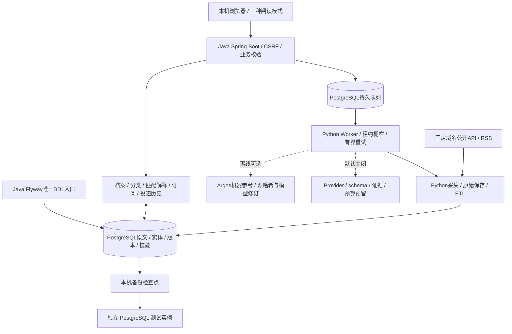
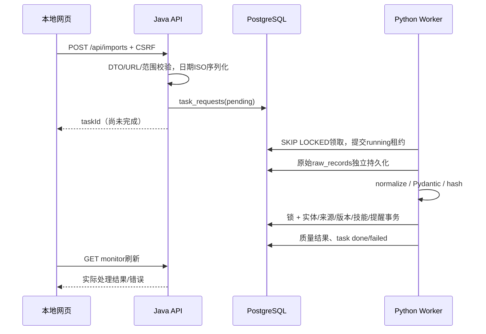

# 架构与运行流程

Java 21 / Spring Boot 4.1 与 Python Worker 共享 PostgreSQL 17。Flyway V1–V12 是唯一迁移入口。运行方式见[合成演示](PUBLIC_DEMO.md)。

## 进程边界

Java Spring Boot在8080提供页面和REST、读写档案/订阅/投递/匹配/提醒、配置来源和入队；Python APScheduler每3秒取数据库队列，每10分钟检查来源是否到6小时采集间隔；PostgreSQL17保存所有事实。单用户本地无Redis/消息代理，无四套独立业务系统。

## 实体与写入职责

Python主要写raw_records/items/companies/item_sources/canonical_aliases/item_versions/job_skills/collection_runs/ai_enrichments/ai_usage；Java写user_profiles/subscriptions/match_results/job_applications/application_history和业务alerts。task_requests由Java/定时Python入队、Worker领取更新；sources配置由Java写、Python更新验证缓存。alerts变化由Python、订阅/日程由Java，唯一dedup_key统一防重。Flyway由Java负责，Python必须等待迁移成功。

Item kind区分job/opportunity/release；企业归属/HQ/所有制与岗位country独立。大陆本土/在华外企中心按employer_reviews已核验归属及主要工作地点区分，待分类/全部存档保留，不复制实体。JSONB承载可选字段，常用筛选列与规范payload在一个事务更新。

## 关键实现

[Pipeline](../data-pipeline-python/src/signalhub/pipeline.py)先原始保存，再normalize。来源标识和官方URL加事务锁；新记录version1，哈希不同version+1，无变化不添版本；规范事务失败不留半个实体，raw仍在。

[Worker](../data-pipeline-python/src/signalhub/worker.py)领取后提交避免HTTP期间锁整张队列；15分钟租约、最多3次，失败不无界循环。Pipeline返回partial也显示task失败。HTTP有公开目标/IP绑定、重试/限流/大小限制，RSS另需域名许可。

[BusinessService](../backend-java/src/main/java/io/signalhub/BusinessService.java)的 refresh 事务以咨询锁串行。规则引擎按岗位版本、档案更新时间、算法修订和企业核验修订重用有效匹配，重算过期项。随后匹配各领域订阅并对提醒去重；每60秒由独立BusinessScheduler调用事务代理，避免同类调用绕过事务。刷新仍扫描候选项并评估订阅，处理量随岗位和订阅数增加。

[MatchingEngine](../backend-java/src/main/java/io/signalhub/MatchingEngine.java)三态硬条件独立于权重；软匹配按已配置维度归一化，不把缺信息判不符合，不把未填技能认作不会。薪资只比较同币种同周期。

AIService单实体会话锁、服务地址/模型/正文hash/档案修订及验证规则修订隔离缓存、月预算咨询锁/预留，结果作为建议保存；不覆盖可信字段。证据校验不是完整语义证明，Mock仍有误分类。免费本地机器翻译是独立可选路径，不使用付费AI接口；源哈希/模型修订/深度与租约控制过期缓存，原文保留。

## 安全和资源

默认127.0.0.1，CSRF写保护、同源CSP和文本节点，无外部字体。采集HTTPS443/公开IP/禁重定向、DNS解析后IP绑定，不能请求用户任意私网URL。导入链接只保存。默认AI disabled，必须另有明确人工授权才能配置付费。

Java384MB/连接4，Python连接2，PG共享缓存64MB；没有压测多用户/公网。Docker Compose 对应三个服务。测试与容器执行范围见[验收说明](PUBLIC_ACCEPTANCE.md)。
