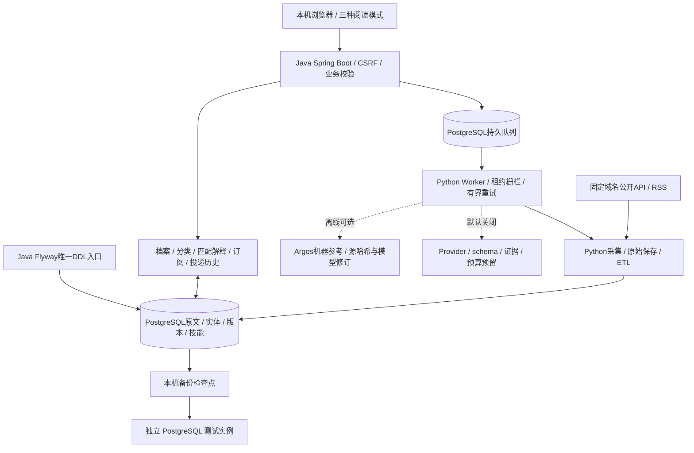
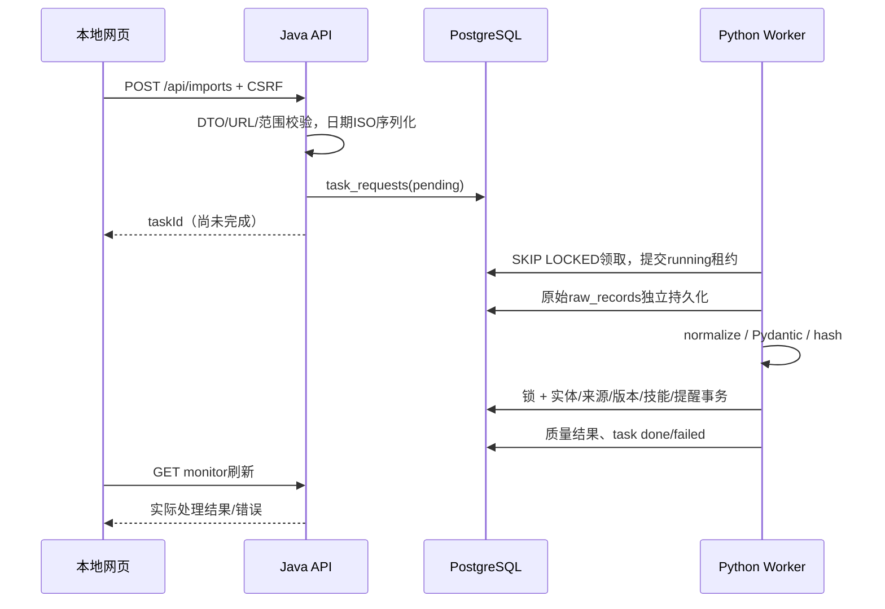

# 架构与运行流程

Java 21 / Spring Boot 4.1 和 Python Worker 共用一个 PostgreSQL 17，表结构只通过 Flyway V1–V12 迁移。运行方式见[合成演示](PUBLIC_DEMO.md)。

## 进程边界

- **Java（Spring Boot，端口 8080）**：提供页面和 REST 接口，读写档案、订阅、投递、匹配和提醒，管理来源配置，并把任务写入队列。
- **Python Worker**：用 APScheduler 每 3 秒从数据库队列里取任务，每 10 分钟检查各来源是否到了 6 小时的采集间隔。
- **PostgreSQL 17**：保存所有数据。

这是单用户的本地项目，没有 Redis 或消息代理，也没有拆成多套独立的业务系统。

## 谁写哪些表

- **Python** 主要写 `raw_records`、`items`、`companies`、`item_sources`、`canonical_aliases`、`item_versions`、`job_skills`、`collection_runs`、`ai_enrichments`、`ai_usage`。
- **Java** 写 `user_profiles`、`subscriptions`、`match_results`、`job_applications`、`application_history` 以及业务提醒（`alerts`）。
- `task_requests` 由 Java 或定时的 Python 入队，Worker 领取并更新。`sources` 的配置由 Java 写，Python 更新验证缓存。
- `alerts` 的变化由 Python 产生，订阅和日程由 Java 写，靠唯一的 `dedup_key` 防重。
- Flyway 迁移由 Java 负责，Python 要等迁移成功后才开始工作。

条目类型分为 `job`、`opportunity`、`release`。企业归属、总部和所有制，与岗位所在国家是各自独立的字段。区分“大陆本土”和“在华外企中心”，依据的是 `employer_reviews` 里核验过的归属和主要工作地点。待分类和全部存档的条目都保留，不会复制实体。可选字段放在 JSONB 里，常用的筛选列和规范化后的 payload 在同一个事务里更新。

## 关键实现

**入库流水线**（[`pipeline.py`](../data-pipeline-python/src/signalhub/pipeline.py)）：先保存原文，再规范化。来源标识和官方 URL 都要加事务锁。新记录是 version 1，哈希不同则 version 加 1，没有变化就不新增版本。规范化事务失败不会留下半个实体，原文仍然保留。

**Worker**（[`worker.py`](../data-pipeline-python/src/signalhub/worker.py)）：领取任务后马上提交，这样在 HTTP 请求期间不会锁住整张队列。租约 15 分钟，最多重试 3 次，失败不会无限循环。流水线返回 `partial` 时，任务也显示为失败。HTTP 请求有公开目标和 IP 绑定、重试、限流和大小限制，RSS 另外需要域名许可。

**租约隔离**：队列采集和导入的每个写入事务，都先锁定任务行，再检查它是否仍处于 `running`、`attempt` 是否一致、租约有没有过期。原文、规范数据、版本、变化提醒、采集运行和来源状态都受这个检查保护，任务结果和失败重试用的也是同一个检查。已经提交的原文和规范记录会保留，任务被接管后重放，仍然靠原有的去重逻辑。请求网络和解析正文期间，不持有任务行的锁。

**匹配刷新**（[`BusinessService`](../backend-java/src/main/java/io/signalhub/BusinessService.java)）：刷新事务用咨询锁串行化。规则引擎根据岗位版本、档案更新时间、算法版本和企业核验版本复用有效的匹配结果，只重算过期的。之后匹配各领域的订阅并对提醒去重。独立的 `BusinessScheduler` 每 60 秒通过事务代理调用刷新，避免同一个类内部的调用绕过事务。刷新仍然要扫描候选项并评估订阅，处理量会随岗位数和订阅数增长。

**匹配规则**（[`MatchingEngine`](../backend-java/src/main/java/io/signalhub/MatchingEngine.java)）：三态的硬性条件独立于权重；软性匹配按已配置的维度归一化，缺少信息不会被判为不符合，没填的技能也不会被当成不会。薪资只在同币种、同周期下比较。

**AI 与翻译**（`AIService`）：同一个条目同一时间只有一个会话（有锁）；缓存按服务地址、模型、正文哈希、档案版本和验证规则版本隔离；月预算用咨询锁和预留额度控制。结果只作为建议保存，不会覆盖可信字段。证据校验不是完整的语义证明，Mock 模式仍可能误分类。免费的本地机器翻译是另一条可选路径，不使用付费 AI 接口，用源哈希、模型版本、深度和租约控制过期缓存，原文始终保留。

## 安全与资源

- 默认监听 127.0.0.1；写操作有 CSRF 保护；CSP 限制为同源，页面只用文本节点渲染，不加载外部字体。
- 采集只走 HTTPS 443 和公开 IP，禁止重定向，DNS 解析后绑定 IP，因此不能请求用户填的任意私网地址。用户导入的链接只保存，不请求。
- AI 默认是 disabled，要配置付费的 AI 必须另有人工的明确授权。
- 资源配置：Java 堆 384MB、连接池 4 个，Python 连接池 2 个，PostgreSQL 共享缓存 64MB。没有做多用户或公网压测。Docker Compose 对应三个服务。

测试与容器的执行范围见[验收记录](PUBLIC_ACCEPTANCE.md)。
